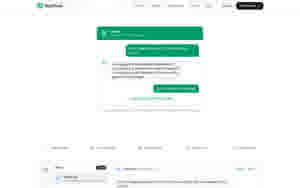

# GudDesk

Open-source live chat and a shared inbox, with a help center. Bring your own AI agent.

[Website](https://guddesk.com) · [Docs](https://guddesk.com/docs) · [Roadmap](ROADMAP.md) · [Contributing](CONTRIBUTING.md)

GudDesk is an Intercom and Zendesk alternative with flat pricing. Use GudDesk Cloud, or self-host this AGPL-3.0 code with no plan limits. If it's useful to you, a star helps other people find it.

<p align="center">
  <a href="https://guddesk.com">
    
  </a>
</p>

## Plans on GudDesk Cloud

| Plan | Price | What you get |
|---|---|---|
| Free | $0 | 2 members, 500 conversations a month |
| Pro | $29 a month flat | Unlimited seats and conversations, no GudDesk branding |

Self-hosting has no plan limits.

## What works today

| Feature | GudDesk Cloud | Self-hosted |
|---|---|---|
| Chat widget (one script tag, with page rules) | Yes | Yes |
| Verified identity for logged-in users (HMAC) | Yes | Yes |
| Shared inbox with assignment and tags | Yes | Yes |
| Email | Outbound via Resend; inbound receiving not live yet | Yes, with Resend inbound |
| Live replies and typing indicators | Yes (Pusher) | With your Pusher keys. Without them, polling every 4 to 10 seconds |
| Public help center | Yes | Yes |
| GudBot (KB-grounded AI replies; default OFF) | Yes | Yes |
| Intercom file importer | Yes | Yes |
| Automation rules | Rules save, but don't run yet | Yes |
| Agent API: your own bot replies as BOT | Yes | Yes |
| REST API and webhooks | Yes | Yes |

## Planned

| Feature | Status |
|---|---|
| Docker image | Yes. `docker compose up --build` after you copy `.env.example` to `.env`. See [docs/self-host.md](docs/self-host.md) |
| WhatsApp and SSO | Not in this release |

See [ROADMAP.md](ROADMAP.md) for the full list.

<p align="center">
  <a href="https://guddesk.com">
    
  </a>
</p>

Built by [GudLab](https://gudlab.org).

## Install the widget (hosted)

```html
<script>window.GudDeskSettings={appId:"gd_pub_xxxxxxxxxxxxxxxx"}</script>
<script src="https://cdn.guddesk.com/widget.js" async></script>
```

Use a `gd_pub_` app ID from **Workspace → Settings → Widget**. Never put server API keys (`gd_live_`, `gd_test_`, Stripe, Anthropic, Pusher secrets) in the snippet or in git.

Self-host: keep the same `appId` and load `https://your-domain/widget.js` instead of the CDN.

## Tech Stack

| Layer | Technology |
|-------|-----------|
| Framework | [Next.js 16](https://nextjs.org) (App Router) |
| Language | [TypeScript](https://typescriptlang.org) |
| Database | [PostgreSQL](https://postgresql.org) via [Prisma 7](https://prisma.io) |
| Auth | [Auth.js v5](https://authjs.dev) |
| Real-time | [Pusher](https://pusher.com) (optional; the widget polls every 4 seconds without it) |
| AI | Optional GudBot / [Anthropic](https://anthropic.com) (default OFF) |
| Email | [Resend](https://resend.com) + [React Email](https://react.email) |
| UI | [Tailwind CSS](https://tailwindcss.com), [Radix UI](https://radix-ui.com), [shadcn/ui](https://ui.shadcn.com) |
| Widget | [Preact](https://preactjs.com) + [Vite](https://vitejs.dev) (Shadow DOM) |

## Getting Started

### Prerequisites

- **Node.js 20.19+** (Prisma 7; 20.18 throws `ERR_REQUIRE_ESM` on `prisma generate`)
- **pnpm**
- **PostgreSQL** (e.g. [Neon](https://neon.tech) or local)

### 1. Clone and install

```bash
git clone https://github.com/gudlab/guddesk-core.git
cd guddesk-core
pnpm install
```

### 2. Environment

```bash
cp .env.example .env.local
```

Fill `DATABASE_URL`, `AUTH_SECRET`, `NEXT_PUBLIC_APP_URL`, `RESEND_API_KEY`, `RESEND_FROM` (a sender on a domain you have verified in Resend), and Google OAuth. Leave Pusher / Stripe / Anthropic empty until you need them. **Do not commit `.env*` files.**

### 3. Database + widget + dev

```bash
pnpm prisma generate
pnpm prisma db push
pnpm run build:widget
pnpm dev
```

Open [http://localhost:3000](http://localhost:3000).

### Docker Compose

```bash
cp .env.example .env
# Set AUTH_SECRET (openssl rand -base64 32). Placeholders work for
# GOOGLE_* and RESEND_API_KEY if you only want the server to start.
docker compose up --build
```

Open [http://localhost:3000](http://localhost:3000). Full steps, env notes, and pitfalls: [docs/self-host.md](docs/self-host.md).

## Performance budgets

| Surface | Budget | Check |
|---|---|---|
| Chat widget (`public/widget.js`) | ≤ 50 KB gzipped | `pnpm run build:widget` |
| Agent inbox list (`GET /api/inbox/conversations`) | p95 < 300 ms | `pnpm measure:inbox` (see [docs/performance.md](docs/performance.md)) |

`build:widget` fails if the gzipped widget is over 50 KB. Inbox numbers are whatever the measure script prints on your machine.

## License

GudDesk is licensed under the [GNU Affero General Public License v3.0](LICENSE) (`AGPL-3.0-only`). The `LICENSE` file and this README agree on that.

## Contributing

See [CONTRIBUTING.md](CONTRIBUTING.md). OSS PRs and stars go to [gudlab/guddesk-core](https://github.com/gudlab/guddesk-core).
